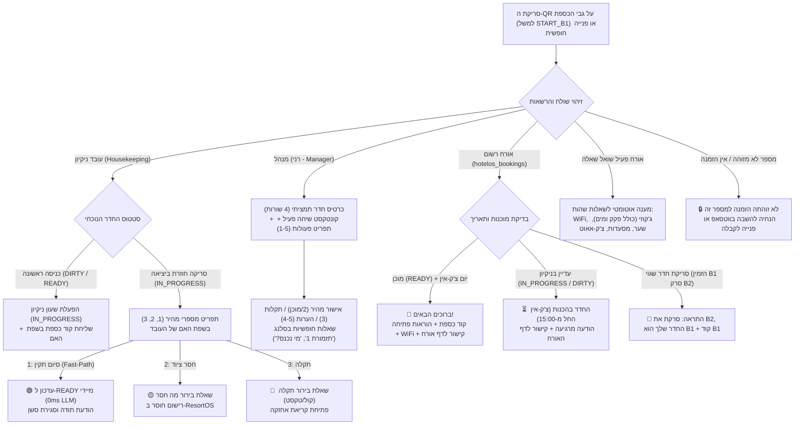

# מערכת מפתחות, כספות וסוכן תפעול חכם ב-WhatsApp (Smart Lockbox QR & Autonomous Ops Agent)
**ResortOS Autonomous Operations Agent**  
*טלפון בוט מרכזי:* `+972 51-526-2612` (`972515262612`)

---

## 1. הקונספט המרכזי: מדבקת QR אוניברסלית אחת

על גבי כל כספת מפתח חיצונית של בקתה/חדר מוצמדת מדבקת QR פיזית אחת.  
ה-QR מכיל קישור עמוק לוואטסאפ:
```text
https://wa.me/972515262612?text=START_<ROOM_CODE>
```
לדוגמה עבור בקתה B1: `https://wa.me/972515262612?text=START_B1`.

**אין צורך בהתקנת אפליקציה ייעודית לאורח או לעובד.**  
הסוכן מזהה את מספר הטלפון של השולח בזמן אמת (פורמט בינלאומי E.164), בודק הרשאות וסטטוס הזמנה, ומתאים את התגובה במדויק:



---

## 2. זרימות עבודה ומכונות מצבים (State Machines)

### א. עובדי ניקיון (Housekeeping & Fast-Path)

1. **סריקת כניסה לחדר (`START_<ROOM>`):**
   - הסטטוס מתעדכן מיידית ל-`IN_PROGRESS`.
   - נרשמת שעת תחילת העבודה (`cleaning_started_at`) והעובד משובץ בחדר.
   - העובד מקבל הודעת אישור עם **קוד הכספת** בשפת האם שלו (תאילנדית, ערבית או עברית).

2. **סריקת יציאה מתפריט מספרי (Exit State Machine):**
   - כאשר עובד סורק שוב את ה-QR ביציאה מחדר שנמצא ב-`IN_PROGRESS` (או שולח "סיום B1" / "EXIT B1"):
   - נשלח תפריט מספרי קצר וברור בשפת העובד:
     - **1:** הכל תקין ומוכן 🟢
     - **2:** חסר ציוד / מצעים / מגבות 🟡
     - **3:** יש תקלה שדורשת תיקון 🔴
     *(ניתן לענות גם בהודעה קולית חופשית).*

3. **עיבוד מענה מספרי (Fast-Path ללא AI):**
   - **מענה `1`:**
     - **Fast-Path אמיתי:** עוקף את מודלי השפה והתמלול (0ms LLM, 0ms Whisper).
     - מעדכן ישירות את החדר ב-ResortOS לסטטוס `READY` (ממתין לביקורת מנהל).
     - שולח הודעת תודה קצרה ומשחרר את הסשן לעבודה הבאה.
   - **מענה `2`:**
     - מעביר את הסשן ל-`AWAITING_SUPPLIES`.
     - שואל בשפת העובד: "מה בדיוק חסר? (אפשר להקליט או לכתוב)".
     - הודעת המענה של העובד (טקסט או הקלטה קולית) נרשמת כדרישת אספקה ב-ResortOS ונשלח אישור.
   - **מענה `3`:**
     - מעביר את הסשן ל-`AWAITING_MAINTENANCE`.
     - שואל בשפת העובד: "מה התקלה? (שלח הקלטה קולית או תמונה)".
     - פותח אוטומטית קריאת אחזקה (Maintenance Alert) ב-ResortOS עם פירוט התקלה.

---

### ב. מנהל (Manager Concise Card, Q&A Context & Slang Engine)

כאשר מנהל (רני - `050-698-3399` / `054-831-7887`) סורק כספת או פונה לבוט:

#### 1. כרטיס חדר תמציתי (Initial Card - ללא עומס)
במקום מגילות טקסט ארוכות, המנהל מקבל תמונת מצב תמציתית ב-4 שורות:
```text
📋 *נופים בלבן 1 (B1)*
🔑 קוד כספת: *2810*
🧹 סטטוס ניקיון: ממתין לניקיון 🔴
👥 סטטוס תפוסה: שוהה כעת (ישראל ישראלי)
```

#### 2. קונטקסט שיחה פעיל (Conversational Context)
לאחר קבלת הכרטיס, המנהל נשאר בתוך הקונטקסט של אותו חדר ויכול להמשיך לשאול שאלות טבעיות:
- *"מי נכנס היום?"* \(\rightarrow\) פירוט שמות, טלפון, שעת כניסה והרכב אורחים להיום.
- *"מי יצא היום?"* \(\rightarrow\) פרטי האורח שעוזב, שעת צ'ק-אאוט וסטטוס הפינוי.
- *"מי בחדר?"* \(\rightarrow\) פרטי האורח הנוכחי.
- *"האם שולם?"* \(\rightarrow\) סטטוס תשלום (שולם במלואו ✅ / ממתין לתשלום ⏳).
- *"כמה אורחים?"* \(\rightarrow\) הרכב מבוגרים וילדים.
- *"קוד כספת"* \(\rightarrow\) שליחה חוזרת של הקוד בלבד.

#### 3. תפריט פעולות מספריות (Action Menu)
- הקלדת **`1`** (או "סטטוס") \(\rightarrow\) תפריט שינוי סטטוס חדר (1: מוכן, 2: בניקיון, 3: ממתין, 4: תקלה).
- הקלדת **`2`** (או "מוכן" / "אישור") \(\rightarrow\) אישור מנהל ישיר (`approveRoomByManager`) המעדכן את החדר ל-READY סופי.
- הקלדת **`3`** (או "תקלה <תיאור>") \(\rightarrow\) פתיחת קריאת אחזקה לחדר זה.
- הקלדת **`4`** (או "הערה <תוכן>") \(\rightarrow\) שמירת הערת חדר פנימית.
- הקלדת **`5`** (או "הערת אורח <תוכן>") \(\rightarrow\) שמירת הערה לתיק ההזמנה של האורח.

#### 4. מנוע זיהוי סלנג, שמות חופשיים והכתבה קולית (Fuzzy Matcher)
המערכת כוללת מנוע מתקדם לפתרון שמות יחידות משובשים, כינויים והכתבות קוליות מהשטח:
- **נרמול הכתבה קולית בעברית:** ממיר מילים למספרים ("תזמורת שתיים" \(\rightarrow\) "תזמורת 2", "טאג' שלוש" \(\rightarrow\) "טאג' 3", "נופים אחת" \(\rightarrow\) "נופים 1").
- **תמיכה באותיות יחס בעברית:** "מה המצב **בתזמורת** 1?", "מי נכנס **לנופים**?".
- **מילון כינויים (Nicknames):**
  - "תזמורת" / "מוזיקלית" \(\rightarrow\) חצר מוזיקלית (D1, D2, D3).
  - "טאג'" / "מאהל" / "לוטוס" \(\rightarrow\) טאג' מאהל (E1..E4).
  - "נופים" / "בלבן" \(\rightarrow\) נופים בלבן (B1, B2).
  - "מול" / "מול הנוף" \(\rightarrow\) מול הנוף (A1..A5).
  - "נורית" / "בתי נורית" \(\rightarrow\) בתי נורית (G1..G8).
  - "טוסקנה" / "איטלקי" \(\rightarrow\) טוסקנה (C1..C3).
  - "מאיה" \(\rightarrow\) בקתות מאיה (F1..F3).
  - "גבעה" \(\rightarrow\) צימר בגבעה (hill-1..hill-4).
- **תגית אימות ברורה (Confirmation Badge):**
  בכל זיהוי של כינוי, המערכת מאמתת עם המנהל בתחילת התשובה:
  `🔍 זיהיתי: *חצר מוזיקלית 1*`
- **מניעת ניחושים (Clarification Flow):**
  כאשר המנהל מציין מתחם ללא מספר ("מה קורה בתזמורת?" או "מי נכנס לנופים?"), המערכת **אינה מנחשת**. היא מציגה תפריט מספרי לבחירת היחידה, שומרת את השאלה המקורית (`pendingQuestion`), וברגע שהמנהל עונה "1" או "2" היא משיבה ישירות על שאלתו המקורית ליחידה שנבחרה.
- **אישור מהיר בסלנג:**
  המנהל יכול לכתוב "מוכן תזמורת 1" או "אישור נופים 2" והחדר יאושר ישירות.
- **דוח תפוסה יומי כולל:**
  הודעות כגון "סטטוס", "דוח", "מה המצב היום" מפיקות דוח תפוסה יומי מרוכז של כל המלון (% תפוסה, החלפות, כניסות, יציאות, חדרים מוכנים, בניקיון ותקלות).

---

### ג. אורח (Guest Digital Stay & Knowledge Engine)

#### 1. סריקת ה-QR בכניסה (Self Check-in)
- **החדר מוכן (READY):**
  - הודעת ברכה אישית עם שם האורח.
  - **קוד כספת המפתח**.
  - **הוראות פתיחה שלב-אחר-שלב** (הזנת הקוד, פתיחת המכסה, הוצאת המפתח, ערבול הגלגלות וסגירה).
  - **קישור אישי לדף האורח הדיגיטלי (Digital Stay Card):**  
    `https://resortos.app/stay/<checkout_token>`
  - רשת וסיסמת WiFi ושעת צ'ק-אאוט רשמית.
- **החדר עדיין בהכנה (IN_PROGRESS / DIRTY):**
  - הודעה מרגיעה שהחדר בהכנות לקראת שעת הכניסה הרשמית (15:00).
  - קישור לדף האורח.
  - קוד הכספת אינו נחשף עד לאישור סופי.
- **הגנה מטעויות חדר:**
  - אם אורח סרק כספת בחדר שאינו שלו, המערכת מתריעה לו מיידית ומכוונת אותו לבקתה הנכונה שלו עם הקוד שלה.

#### 2. מנוע מענה לשאלות אורחים בווטסאפ (Guest Knowledge Engine)
הבוט כולל גישה לכל המידע התפעולי של המתחם ומשיב לשאלות אורחים במהלך השהות:
- **רשתות וסיסמאות WiFi:** התאמה לפי מתחם החדר (למשל `Nofim-Balaban`, סיסמה `nofim2024`).
- **הפעלת ג'קוזי (4 שלבים ברורים):**
  1. וידוא פקק הגומי השחור הדק בתחתית סגור היטב.
  2. מילוי מים עד מעל לגובה כל הג'טים (למניעת הפעלה יבשה).
  3. לחיצה על לחצן האוויר הפנאומטי בדופן להפעלת הזרמים.
  4. בסיום השימוש: שליפת הפקק לריקון המים.
- **שער כניסה למושב:** קוד כניסה `#2464` ושעות פעילות השער.
- **המלצות אוכל ומסעדות באזור:** מושבוץ (בשרים ברמות), מרינדו (עין גב), מוייזה, בשרים וחומוס מקומי.
- **צ'ק-אאוט:** שעת עזיבה (11:00) וקישור לצ'ק-אאוט דיגיטלי בלחיצה אחת.

---

## 3. קטלוג כספות וחדרים (40 יחידות פעילות)

| קוד אות | שם רשמי במערכת | מתחם | מזהה מערכת | קוד כספת מפתח |
|:---:|:---|:---|:---:|:---:|
| **A1** | מול הנוף · בקתה 1 | מול הנוף | `k680` | `2910` |
| **A2** | מול הנוף · בקתה 2 | מול הנוף | `k681` | `2920` |
| **A3** | מול הנוף · בקתה 3 | מול הנוף | `k682` | `2930` |
| **A4** | מול הנוף · בקתה 4 | מול הנוף | `k683` | `2940` |
| **A5** | מול הנוף · בקתה 5 | מול הנוף | `k684` | `2950` |
| **B1** | נופים בלבן · בקתה 1 | נופים בלבן | `k685` | `2810` |
| **B2** | נופים בלבן · בקתה 2 | נופים בלבן | `k686` | `2820` |
| **C1** | טוסקנה 1 | טוסקנה | `k687` | `2710` |
| **C2** | טוסקנה 2 | טוסקנה | `k688` | `2720` |
| **C3** | טוסקנה 3 | טוסקנה | `k689` | `2730` |
| **D1** | חצר מוזיקלית 1 | חצר מוזיקלית | `k690` | `2610` |
| **D2** | חצר מוזיקלית 2 | חצר מוזיקלית | `k691` | `2620` |
| **D3** | חצר מוזיקלית 3 | חצר מוזיקלית | `k692` | `2630` |
| **E1** | טאג' מאהל 1 | טאג' מאהל | `k808` | `2510` |
| **E2** | טאג' מאהל 2 | טאג' מאהל | `k809` | `2520` |
| **E3** | טאג' מאהל 3 | טאג' מאהל | `k810` | `2530` |
| **E4** | טאג' מאהל 4 | טאג' מאהל | `k811` | `2540` |
| **F1** | בקתות מאיה 1 | בקתות מאיה | `k693` | `2410` |
| **F2** | בקתות מאיה 2 | בקתות מאיה | `k694` | `2420` |
| **F3** | בקתות מאיה 3 | בקתות מאיה | `k695` | `2430` |
| **G1** | בתי נורית 1 | בתי נורית | `k671` | `2310` |
| **G2** | בתי נורית 2 | בתי נורית | `k673` | `2320` |
| **G3** | בתי נורית 3 | בתי נורית | `k674` | `2330` |
| **G4** | בתי נורית 4 | בתי נורית | `k675` | `2340` |
| **G5** | בתי נורית 5 | בתי נורית | `k676` | `2350` |
| **G6** | בתי נורית 6 | בתי נורית | `k677` | `2360` |
| **G7** | בתי נורית 7 | בתי נורית | `k678` | `2370` |
| **G8** | בתי נורית 8 | בתי נורית | `k679` | `2380` |
| **Hill 1** | צימר בגבעה 1 | צימר בגבעה | `hill-1` | `3041` |
| **Hill 2** | צימר בגבעה 2 | צימר בגבעה | `hill-2` | `3042` |
| **Hill 3** | צימר בגבעה 3 | צימר בגבעה | `hill-3` | `3043` |
| **Hill 4** | צימר בגבעה 4 | צימר בגבעה | `hill-4` | `3044` |
| **Villa** | וילה מיאליס | מיאליס | `mialis-villa` | `3050` |
| **Casanova 1** | קאסה נובה - אורה | קאסה נובה | `k826` | `3010` |
| **Casanova 2** | קאסה נובה - בלום | קאסה נובה | `k827` | `3020` |
| **Office** | משרד הנהלה | משרד | `pilot-office` | **`1357#`** |

---

## 4. ארכיטקטורה, ביצועים ו-Latency

1. **זמני תגובה תת-שנייתיים (Sub-second Response Time):**
   - **In-Memory TTL Caching:** קריאות `listUnits` נשמרות במטמון ל-15 שניות ו-`listBookings` ל-20 שניות, עם אינוולידציה מיידית בכל שינוי סטטוס (Mark Ready, Maintenance, Note).
   - **הסרת השהיות מלאכותיות:** בוטלה המתנת ההקלדה המלאכותית (`setTimeout 3500ms`) שהאטה את המענה.
   - **Per-Chat JID Queue:** תור עיבוד נפרד לפי צ'אט מונע צוואר בקבוק גלובלי.
   - **Fast-Path דטרמיניסטי:** פקודות תפעוליות שכיחות מעובדות ב-<0.1ms ללא פנייה ל-LLM.
   - **Timeout מוקטן ל-ResortOS:** הוקטן מ-10 שניות ל-2 שניות למניעת תקיעות.

2. **אבטחה והרשאות (RBAC):**
   - קודי כספות נחשפים אך ורק לעובדים משובצים, למנהלים מאושרים או לאורחים רשומים ביום הגעתם כאשר החדר מאושר.
   - מספרים בלתי מזוהים אינם מקבלים גישה למידע פנימי.

---

## 5. בדיקות ואימות (Test Suite)

כל רכיבי המערכת מכוסים ב-**61 בדיקות יחידה אוטומטיות מלאות ב-Vitest**:
- תמלול קולי בתאילנדית וערבית ומענה בשפת האם.
- מכונת המצבים המספרית של עובדי הניקיון (Fast-Path 1, supplies 2, maintenance 3).
- זיהוי סריקת יציאה אוטומטית לעובד שחדרו ב-IN_PROGRESS.
- כרטיס מנהל תמציתי ומכונת המצבים של המנהל (פעולות 1-5).
- שימור קונטקסט שיחה ושאלות המשך של מנהל.
- מנוע זיהוי סלנג, שמות משובשים, הכתבה קולית ("תזמורת 1", "טאג' שלוש").
- מנגנון בירור חכם למניעת ניחושים במתחם מעורפל.
- מנוע הידע לאורחים (WiFi, ג'קוזי כולל פקק ומים, שער, מסעדות, צ'ק-אאוט).
- מניעת שגיאות ניתוב לאורח שסרק חדר שגוי.

להרצת הבדיקות:
```bash
npm --prefix services/resortos-agent test
```
תוצאה: **100% עובר (61/61 בדיקות, ~1.2 שניות)**.
