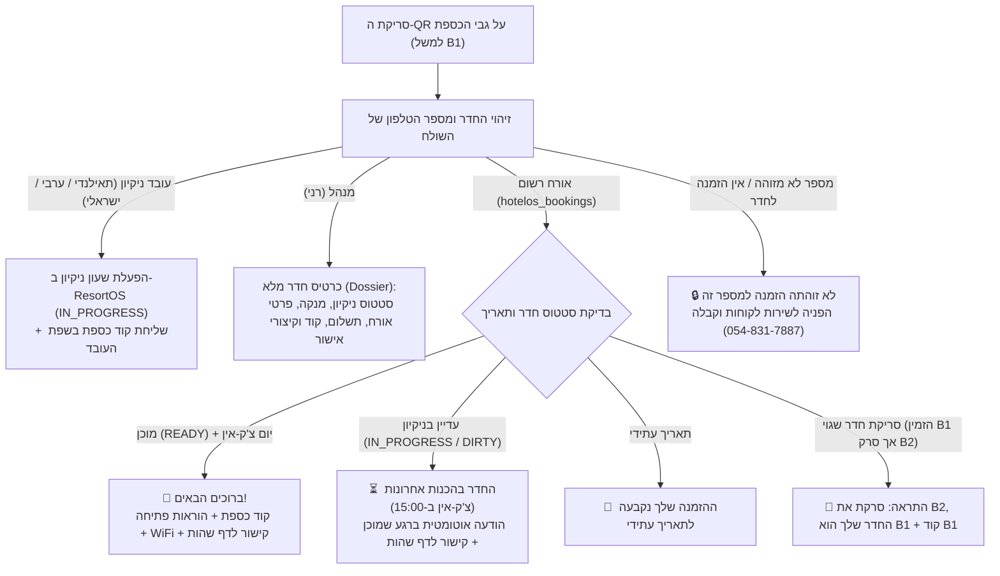

# מערכת מפתחות וכספות חכמה ב-WhatsApp (Smart Lockbox QR System)
**ResortOS Autonomous Operations Agent**  
*טלפון בוט מרכזי:* `+972 51-526-2612` (`972515262612`)

---

## 1. הקונספט המרכזי: מדבקת QR אוניברסלית אחת
על גבי כל כספת מפתח חיצונית של בקתה/חדר מוצמדת מדבקת QR פיזית אחת.  
ה-QR מכיל קישור עמוק לוואטסאפ:
```text
https://wa.me/972515262612?text=START_<ROOM_CODE>
```
לדוגמה עבור בקתה B1: `https://wa.me/972515262612?text=START_B1`.

**אין צורך באפליקציה ייעודית לאורח או לעובד.**  
הבוט מזהה את מספר הטלפון של השולח בזמן אמת (E.164) ומתאים את התגובה במדויק לפי התפקיד וההרשאות:



---

## 2. התנהגות המערכת לפי תפקידים

### א. אורח (Guest Digital Self-Check-in)
כאשר אורח מגיע לדלת החדר וסורק את ה-QR:
1. **זיהוי האורח:** המערכת בודקת את מספר הטלפון בטבלת ההזמנות (`hotelos_bookings`).
2. **הגנה מפני טעויות חדר:** אם האורח סרק כספת של חדר אחר (למשל סרק את B2 אך החדר שלו הוא B1), הבוט מזהה זאת מיידית, מתריע לו בנימוס ומכוון אותו לחדר הנכון עם הקוד שלו!
3. **בדיקת מוכנות החדר (READY):**
   - **החדר מוכן (READY):**
     - האורח מקבל הודעת קבלת פנים חמה עם שמו.
     - **קוד הכספת** המדויק של החדר שלו.
     - **הוראות פתיחה שלב-אחר-שלב** (הזנת הקוד בגלגלות, לחיצה על מתג הפתיחה, הוצאת המפתח, ערבול הגלגלות וסגירה).
     - **קישור אישי לדף שהות דיגיטלי** עם הטוקן הייחודי שלו:  
       `https://resortos.app/stay/<checkout_token>`
     - קוד WiFi ושעת צ'ק-אאוט.
   - **החדר עדיין בהכנה (IN_PROGRESS / DIRTY):**
     - האורח מקבל הודעה מרגיעה שהצוות מכין עבורו את החדר לקראת שעת הצ'ק-אין (15:00).
     - לא נחשף קוד הכספת טרם אישור המנהל.
     - נשלח קישור לדף האורח לצפייה בפרטי ההזמנה.
     - ברגע שהמנהל מאשר את החדר כ-READY, נשלח קוד הכספת.

### ב. מנהל (Manager Dossier & Quick Actions)
כאשר מנהל (רני - `050-698-3399` / `054-831-7887`) סורק את ה-QR או שולח הודעה עם קוד חדר (למשל `B1`):
1. **לא מופעל שעון ניקיון של עובד.**
2. **נשלח תיק חדר תפעולי מלא (Dossier):**
   - שם החדר, אות באנגלית, מתחם.
   - **קוד כספת מפתח**.
   - **סטטוס תפעולי חי** (מוכן 🟢, בניקיון 🟡, ממתין 🔴, תקלה ⚠️).
   - מי המנקה המשויך והערות מיוחדות.
   - **פרטי האורח להיום:** שם, טלפון, תאריכי שהות, הרכב נפשות (מבוגרים/ילדים), סטטוס תשלום, וקישור ישיר לדף האורח הדיגיטלי.
3. **אישור חדר מהיר במילה אחת:**
   - המנהל משיב: `מוכן B1` או `אישור B1`.
   - המערכת מעדכנת את החדר ב-ResortOS ל-`READY` עם הערה `אושר ע״י מנהל`.
4. **בקשת מדבקת QR בוואטסאפ:**
   - המנהל שולח: `שלח QR של B1` או `QR משרד`.
   - הבוט מחזיר תמונת PNG חדה של ה-QR להדפסה מיידית.

### ג. עובדי ניקיון (Housekeeping)
1. **הפעלה מהירה (0ms LLM):** סריקת ה-QR מתועדת ב-ResortOS מיידית:
   - סטטוס החדר הופך ל-`IN_PROGRESS`.
   - שעת תחילת הניקיון נרשמת (`cleaning_started_at`).
   - העובד משובץ בחדר (`assigned_staff = cleaner.name`).
2. **קבלת קוד הכספת בשפת העובד:**
   - תאילנדית: `บันทึกเรียบร้อยค่ะ: คุณטופ เริ่มทำความสะอาดห้อง B1 แล้วค่ะ ✅ 🔑 รหัสตู้เซฟกุญแจ: 2810`
   - ערבית: `أهلاً أبو، تم تسجيل بدء تنظيف غرفة B1 بنجاح! ✅ 🔑 كود صندوق المفتاح: 2810`
   - עברית: `היי אוסנת, נרשם בהצלחה שהתחלת לנקות את חדר B1! ✅ 🔑 קוד כספת מפתח: 2810`

---

## 3. קטלוג כספות וחדרים (41 יחידות)

| אות / מזהה | שם רשמי במערכת | מתחם | מזהה מערכת | קוד כספת מפתח |
|:---:|:---|:---|:---:|:---:|
| **A1** | מול הנוף · בקתה 1 | מול הנוף | `k680` | `2910` |
| **A2** | מול הנוף · בקתה 2 | מול הנוף | `k681` | `2920` |
| **A3** | מול הנוף · בקתה 3 | מול הנוף | `k682` | `2930` |
| **A4** | מול הנוף · בקתה 4 | מול הנוף | `k683` | `2940` |
| **A5** | מול הנוף · בקתה 5 | מול הנוף | `k684` | `2950` |
| **B1** | נופים בלבן · בקתה 1 | נופים בלבן | `k685` | `2810` |
| **B2** | נופים בלבן · בקתה 2 | נופים בלבן | `k686` | `2820` |
| **C1** | שוויצריה בגליל · בקתה 1 | שוויצריה בגליל | `k687` | `2710` |
| **C2** | שוויצריה בגליל · בקתה 2 | שוויצריה בגליל | `k688` | `2720` |
| **C3** | שוויצריה בגליל · בקתה 3 | שוויצריה בגליל | `k689` | `2730` |
| **D1** | חלום גלילי · סוויטה 1 | חלום גלילי | `k690` | `2610` |
| **D2** | חלום גלילי · סוויטה 2 | חלום גלילי | `k691` | `2620` |
| **D3** | חלום גלילי · סוויטה 3 | חלום גלילי | `k692` | `2630` |
| **E1** | טאג' מאהל · סוויטה 1 | טאג' מאהל | `k808` | `2510` |
| **E2** | טאג' מאהל · סוויטה 2 | טאג' מאהל | `k809` | `2520` |
| **E3** | טאג' מאהל · סוויטה 3 | טאג' מאהל | `k810` | `2530` |
| **E4** | טאג' מאהל · סוויטה 4 | טאג' מאהל | `k811` | `2540` |
| **F1** | סוויטות מול האגם 1 | סוויטות מול האגם | `k693` | `2410` |
| **F2** | סוויטות מול האגם 2 | סוויטות מול האגם | `k694` | `2420` |
| **F3** | סוויטות מול האגם 3 | סוויטות מול האגם | `k695` | `2430` |
| **G1** | אחוזת הנוף · סוויטה 1 | אחוזת הנוף | `k671` | `2310` |
| **G2** | אחוזת הנוף · סוויטה 2 | אחוזת הנוף | `k672` | `2320` |
| **G3** | אחוזת הנוף · סוויטה 3 | אחוזת הנוף | `k673` | `2330` |
| **G4** | אחוזת הנוף · סוויטה 4 | אחוזת הנוף | `k674` | `2340` |
| **G5** | אחוזת הנוף · סוויטה 5 | אחוזת הנוף | `k675` | `2350` |
| **G6** | אחוזת הנוף · סוויטה 6 | אחוזת הנוף | `k676` | `2360` |
| **G7** | אחוזת הנוף · סוויטה 7 | אחוזת הנוף | `k677` | `2370` |
| **G8** | אחוזת הנוף · סוויטה 8 | אחוזת הנוף | `k678` | `2380` |
| **Hill 1** | על הגבעה · יחידה 1 | על הגבעה | `hill-1` | `3041` |
| **Hill 2** | על הגבעה · יחידה 2 | על הגבעה | `hill-2` | `3042` |
| **Hill 3** | על הגבעה · יחידה 3 | על הגבעה | `hill-3` | `3043` |
| **Hill 4** | על הגבעה · יחידה 4 | על הגבעה | `hill-4` | `3044` |
| **Villa** | וילה מיאליס | מיאליס | `mialis-villa` | `3050` |
| **Office** | משרד | משרד | `pilot-office` | **`1357#`** |

*(ועוד יחידות משנה: סוויטה נשיאותית, אגף גג, קראוון).*

---

## 4. הדפסת מדבקות ה-QR (Ready to Print)
קובץ הדפסה מוכן לכל 41 הכספות בפורמט A4 מעוצב נמצא ב:
`services/resortos-agent/data/qr-stickers.html`

לייצור מחדש של המדבקות:
```bash
cd services/resortos-agent
npx tsx scripts/gen-qr-sheet.ts
open data/qr-stickers.html
```

---

## 5. בדיקות ואימות (Test Suite)
המערכת מכוסה ב-30 בדיקות יחידה אוטומטיות ב-Vitest:
- זיהוי קול ומסרונים בתאילנדית, ערבית ועברית.
- סינון והגנה על הרשאות (RBAC) ומניעת חשיפת מידע לזרים.
- תיק חדר מנהל ואישור מהיר.
- ניתוב אורחים לקוד כספת ולהוראות פתיחה.
- הפקת קישור לדף שהות אישי עם הטוקן.
- מניעת טעויות כניסה לחדרים אחרים.

להרצת הבדיקות:
```bash
npm test
```
תוצאה: **100% עובר (30/30 בדיקות)**.
